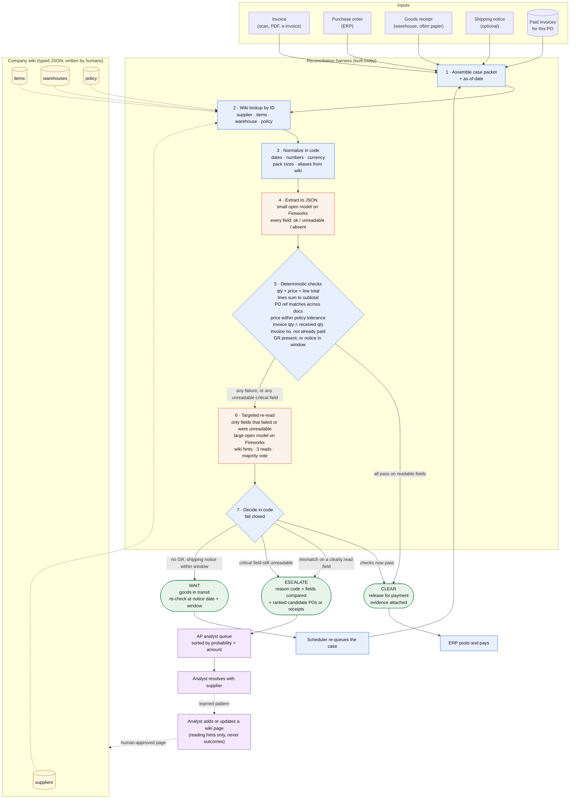

# Problem statement

**Claim.** On invoices that are messy but correct, a frontier model escalates to a human far more often than it needs to. A harness of open models on Fireworks, with code as the authority and the model limited to reading, can cut those false escalations while still catching every real problem, at a fraction of the cost. We measure this on a published benchmark with a hard safety constraint.

The build plan is in [plan.md](plan.md) and the source notes in [notes/](notes/).

---

## 1. The domain in sixty seconds

Every company that buys things runs the same check before paying a supplier. Three documents must agree:

| Document | Who creates it | What it proves |
|---|---|---|
| **Purchase order (PO)** | The buyer | What was ordered, at what price |
| **Goods receipt (GR)** | The buyer's warehouse, when the shipment lands | What actually arrived |
| **Invoice** | The supplier | What the supplier wants to be paid for |

If quantity and price line up across all three, within a small tolerance, the invoice is paid automatically. If not, a person investigates. This is called three-way matching, and it is the control that stops a company paying for things it never ordered or never received.

A concrete case:

```
PO  #4471      Blue Widget      qty 12 EA    @ $8.00
GR  for #4471  Blue Widget      qty 12       (handwritten "12 ✓ JM" at the top)
Invoice INV-8812, ref "P.O. 4471"   1 CS (12 EA) Blue Widget   $96.00
```

A human clears this in five seconds. The case, the handwriting, and the reference format are noise. The documents agree. Most automated systems escalate it, because a parser cannot read "1 CS (12 EA)" as 12, or does not trust a handwritten number, or cannot find a PO reference in a format it has not seen.

## 2. Why it matters

| Figure | Source |
|---|---|
| 18.4% of invoices are escalated to a person | [Ardent Partners, 2025](https://payablesplace.ardentpartners.com/2026/01/state-of-epayables-part-nine-ap-benchmarks-and-best-in-class-performance/) |
| $9.84 fully loaded cost per invoice, 8.2 days to process | Ardent Partners, 2025 |
| Even best-in-class teams escalate 9% and reach only about 49% touchless | [Ardent 2024](https://payablesplace.ardentpartners.com/2025/01/best-of-2024-ap-performance-advantages-of-best-in-class/); Hackett via [Corpay](https://www.corpay.com/en-CHI/resources/blog/ap-team-productivity-benchmarks) |
| In an open reconciliation project, matching rules were right on 99.3% of clean documents, yet 48.4% of documents still went to review, because line-item extraction scored F1 0.37 | [docmatch](https://github.com/franklinmdev/docmatch) |

The last row is the whole story. **The matching logic is solved. The reading is not.** Invoices arrive in hundreds of layouts as scans and PDFs. Goods receipts are paper, signed by a driver, annotated by hand. When the extraction step cannot read a critical field, the only safe move is to hand the case to a person. Every commercial product does exactly that: [Stampli](https://www.stampli.com/resources/how-ai-invoice-processing-works/) routes any field under a confidence threshold to review whether or not the documents agree, and [Basware's new agent](https://customer.basware.com/en/features/matching-agent-ai-powered-guidance-for-invoice-matching-discrepancies) only explains a discrepancy after a human opens it.

So the human review queue is dominated by invoices that were fine. If roughly one in five invoices is escalated and the true discrepancy rate on PO-backed invoices is a few percent, most of an analyst's day is spent confirming that nothing was wrong. At enterprise volume that is thousands of reviews a month and real money in delayed payments and forfeited early-payment discounts. **No vendor publishes a false-escalation rate with a denominator.** That is the gap we fill.

## 3. The machine learning problem

Strip away the domain and this is **selective classification with an asymmetric cost and a hard constraint**, in the sense of [Geifman and El-Yaniv](https://arxiv.org/abs/1705.08500) and the learning-to-defer framing of [Mozannar and Sontag](https://proceedings.mlr.press/v119/mozannar20b.html).

Input: a case packet. PO text, invoice text, GR text (may be absent), an optional shipping notice, the list of invoice numbers already paid on that PO, company reference knowledge, and an as-of date.

Output: one of three actions.

| Action | Meaning | Human involved |
|---|---|---|
| **CLEAR** | Documents agree within tolerance. Pay. | No |
| **WAIT** | GR absent, shipping notice says goods are in transit. Re-check later. | No |
| **ESCALATE** | Documents disagree on a clearly read field, or a critical field could not be read. | Yes |

The two errors are not symmetric:

- A **false CLEAR** on a real discrepancy leaks money and breaks an audit control. This must not happen.
- A **false ESCALATE** on an agreeing invoice costs one human review, about $10. This is what we minimize.

That asymmetry fixes the metric. We report the **false escalation rate on agreeing cases, subject to 100% recall on real discrepancies**, both with confidence intervals. Accuracy and F1 are the wrong headline numbers for this problem: they trade the two error types against each other at whatever class mix the test set happens to have, and they hide a missed discrepancy behind a hundred correct clears.

## 4. Why a frontier model alone does not win here

A judge's natural question: why not just give GPT-class model the three documents and ask? We run exactly that as the baseline. We expect it to lose on this task, for four reasons that are structural rather than about model size.

1. **It answers when it should abstain.** Asked for a quantity it cannot read, a generative model produces a number. On this task a confident wrong number on a critical field is the worst possible output. The system needs per-field abstention, and that has to be enforced outside the model.
2. **It does arithmetic and cross-referencing in tokens.** Twelve times eight, lines summing to a subtotal, an invoice number appearing in a paid list, a date inside a ten-day window. These are deterministic checks that code gets right every time and a model gets right most of the time. "Most of the time" is not acceptable when a miss is a leaked payment.
3. **Its output is sensitive to things that should not matter.** Prompt formatting alone moves accuracy by double digits ([Sclar et al.](https://arxiv.org/abs/2310.11324)). Document order, layout, and field position are exactly the noise in our data.
4. **It does not know this company.** Whether a handwritten count on this supplier's receipt is authoritative, whether "1 CS" is 12 units for this SKU, whether this supplier ships from Reno although the PO says Dallas: that is tribal knowledge held by analysts and absent from any model's training data. It has to be supplied, in a form code can use.

None of these are fixed by a bigger model. All of them are fixed by a harness. And once the model's job is reduced to reading fields it is pointed at, a small open model is enough, which is where the cost advantage comes from.

## 5. What we built

A reconciliation harness where code is the authority and the model is a reader. One invoice moves through it like this. Blue boxes are code, orange are the only two model calls, purple are people. The dashed learning loop is described in the demo and not built today.



### What each step guarantees

| Step | Who does it | Guarantee |
|---|---|---|
| 1 Assemble | code | Every arm and every run sees the same packet. Nothing is fetched later. |
| 2 Wiki lookup | code | Deterministic, by ID. No search, no retrieval error. Missing page is fine. |
| 3 Normalize | code | One canonical form for dates, numbers, units and names before any model sees them. |
| 4 Extract | small model | Structured JSON with a status per field. The model may not guess a value it cannot read. |
| 5 Checks | code | Arithmetic and cross-document comparison. This is the authority. A model never overrides it. |
| 6 Re-read | large model | Spends tokens only on fields that failed. Wiki pages tell it where to look and what is authoritative. |
| 7 Decide | code | Fail closed. The only path to CLEAR is every check passing on fields marked readable. |

### Where the model is and is not

The two orange boxes are the only places a model runs. It reads. It does not decide, approve, compute totals, invent conversions, or widen tolerances. Everything a judge or auditor would want to trace is in the blue boxes and is deterministic.

### The learning loop

The dotted path from the analyst back to the wiki is how the system gets better per company. A reviewer who clears a case because "this supplier writes the received count by hand" records that once, as a typed page with an author, approver and expiry. The next invoice from that supplier is read correctly and never reaches the queue. Nothing extracted from a document is ever written to the wiki automatically. This loop is described in the demo and is not built today.

### Three outcomes, three destinations

| Outcome | Goes to | Counts as a human escalation |
|---|---|---|
| CLEAR | ERP, posted and paid | No |
| WAIT | Scheduler, re-queued after the notice window | No |
| ESCALATE | Analyst queue, with reason code, fields compared, and candidate matches attached | Yes |

The benchmark measures how often agreeing invoices end up in the third row, while every real discrepancy must end up there.

The wiki is deliberately simple: typed JSON looked up by ID, written by humans, describing how to read, never what to conclude. Pages can be stale, irrelevant, or adversarial, and the test set includes all three.

## 6. How we prove it

- **150 held-out synthetic cases** with known labels: 45 clean, 60 messy but agreeing, 38 real discrepancies across five types, 7 in transit. Twelve noise types. One document layout and one supplier appear only in the test set. A separate 50-case dev set is used for all tuning; the test file is hashed before any system runs on it.
- **Four arms on identical inputs:** a rules-only matcher (the industry status quo), a frontier model with one prompt and the same output schema (the judged baseline), the same open model without the harness (the ablation), and our harness.
- **One scorer.** False escalation rate on the 105 agreeing cases with a 95% interval, the safety gate as a count out of 38 with an exact interval, a paired McNemar test between our harness and the baseline, per-stratum breakdowns, and tokens, dollars and latency per case. The table is generated only from saved raw outputs, which are committed.

What a win looks like:

| Arm | Real discrepancies caught | False escalations on agreeing cases | $ per 100 invoices |
|---|---:|---:|---:|
| Rules only | 38/38 | high | ~0 |
| Frontier baseline | 38/38 | X% | high |
| Open model, no harness | ? | ? | low |
| **Our harness** | **38/38** | **well below X%** | **low** |

The claim we make is only as strong as that table, and we say so in the limitations: synthetic data shows controlled task performance, not enterprise generalization or payment safety.

## 7. What else this unlocks

Nothing in the harness is specific to invoices. The pattern is: several documents that should agree, produced by different parties in different formats, where a mismatch on a clearly read field means money or risk, and where today a person reviews everything the reader could not parse. Swap the documents and the checks, keep the architecture.

### Inside accounts payable

| Use case | Documents that must agree | What escalates today for no reason |
|---|---|---|
| Non-PO invoices | Invoice against contract or rate card | Rate card is a PDF, invoice line descriptions do not match contract wording |
| Credit memos and returns | Credit memo against return authorization and original invoice | Return paperwork is handwritten at the dock |
| Duplicate and fraud screening | New invoice against payment history and vendor master | Same invoice resubmitted with a different number format |
| Vendor onboarding | W-9, bank letter, insurance certificate against the vendor record | Scanned certificates in varied layouts |

### The same pattern in other functions

| Domain | Documents that must agree | Why the reading is hard |
|---|---|---|
| **Freight audit** | Carrier invoice, bill of lading, contracted rate table | Accessorial charges written in carrier jargon, weights hand-corrected |
| **Expense management** | Receipt, card transaction, expense claim, policy | Thermal receipts, foreign currency, merchant name variants |
| **Insurance claims** | Claim form, policy, repair estimate, photos | Estimates from thousands of body shops in their own formats |
| **Medical billing** | Claim, explanation of benefits, remittance advice | Payer-specific codes, partial payments across multiple remittances |
| **Customs and trade** | Commercial invoice, packing list, bill of lading, declaration | Mixed units, HS code variants, multi-language documents |
| **Bank reconciliation** | Bank statement lines, ledger entries, remittance notes | One payment covering many invoices with a free-text reference |
| **Payroll** | Timesheets, schedules, contracts | Handwritten or photographed timesheets, shift differentials |
| **Lease and utility audit** | Utility bill, meter reading, tariff schedule | Tariff tables as PDFs, estimated versus actual reads |
| **Rebates and chargebacks** | Claim, promotion agreement, sell-through data | Retailer deduction codes, partial claims |
| **Grant and audit compliance** | Expenditure report, receipts, award terms | Allowability rules in prose, receipts in any format |

In every row the structure is identical: deterministic checks are the authority, a model reads fields it is pointed at and is allowed to say "unreadable," a typed knowledge base holds the local conventions, and a human sees only the cases where clearly read fields disagree.

### Why the benchmark design transfers too

The metric transfers with the architecture. Each of these domains has one costly error, paying or approving something that is wrong, and one cheap error, asking a person to look at something that was fine. "Minimize cheap errors subject to zero costly errors, with intervals" is the right headline number for all of them, and in none of them does a vendor publish it today.

## 8. One sentence

We teach open models to tell the difference between an invoice that is wrong and an invoice that is merely hard to read, so people only look at the ones that are actually wrong.
