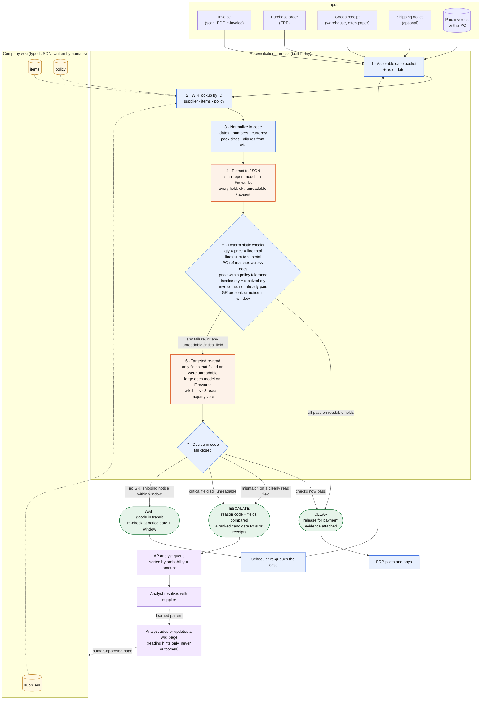

# Why we are building this, and what it is worth

The build plan is in [plan.md](plan.md). Sources for every number are in [notes/](notes/).

---

## Start with Maria

Maria runs accounts payable for a mid-sized manufacturer. Every morning about a hundred supplier invoices land in her queue. Before any of them gets paid, three documents have to agree: the purchase order her company issued, the receipt her warehouse signed when the shipment arrived, and the invoice the supplier sent. Same item, same count, same price. If they line up, the invoice pays itself. If they don't, Maria or someone on her team has to stop and figure out why.

Here is what her Tuesday looks like. Twenty of those hundred invoices get flagged. She opens the first one. The supplier wrote "1 case (12 units)" where the order said "12 EA." Fine. Next one. The warehouse guy wrote the delivered count by hand at the top of the slip because the printer was out. Fine. Next one. The PO number is there, just formatted "P.O. 4471" instead of "PO-004471." Fine. Fourth one: the invoice bills for 12, the receipt says 10. That one is real. She emails the supplier.

Three out of four flags were nothing. She knew it in five seconds each. The software didn't.

## This is not a small problem

Industry surveys put the average exception rate at about one invoice in five, and the cost of handling an invoice at roughly ten dollars ([Ardent Partners, 2025](https://payablesplace.ardentpartners.com/2026/01/state-of-epayables-part-nine-ap-benchmarks-and-best-in-class-performance/)). Even the best-run AP teams still flag about one in ten, and even they only get around half their invoices through with no human touch at all ([Ardent 2024](https://payablesplace.ardentpartners.com/2025/01/best-of-2024-ap-performance-advantages-of-best-in-class/); Hackett via [Corpay](https://www.corpay.com/en-CHI/resources/blog/ap-team-productivity-benchmarks)). A company processing 30,000 invoices a month is paying people to look at 6,000 of them.

What nobody publishes is how many of those 6,000 were fine. Our bet is: most of them. We have not measured it yet, and we are honest about that. But there is a strong hint in the one open project we found that tried this end to end: its matching rules were right 99.3% of the time on clean documents, and it still sent 48% of documents to a human, because the step that reads the document scored an F1 of 0.37 ([docmatch](https://github.com/franklinmdev/docmatch)).

The matching isn't the problem. The reading is.

Put numbers on it, with the caveat that the split is our hypothesis. Take that 30,000-invoice company. If half of its 6,000 monthly flags are false, that is 3,000 reviews a month that should never have happened, roughly $30,000 a month in handling cost at the industry average, before counting the early-payment discounts lost while invoices sit in a queue for eight days. The buyer is the controller or CFO who owns that line. The user is Maria.

## Why hasn't anyone fixed this

Everyone has tried. Every AP product on the market does some version of "rules first, then flag what we can't handle." The rules are good. The flagging is where the money goes.

Here is the trap. When a system can't read a number, the only safe thing to do is ask a human. That's correct. A payment control that guesses is worse than one that asks. So vendors tune for safety, set a confidence threshold, and route anything under it to a person. [Stampli](https://www.stampli.com/resources/how-ai-invoice-processing-works/) describes exactly this. [Basware](https://customer.basware.com/en/features/matching-agent-ai-powered-guidance-for-invoice-matching-discrepancies) shipped an AI agent this fall that explains a discrepancy, but only after a human has already opened the case. Nobody lets the AI clear an invoice that the rules couldn't parse.

The result is that every improvement in reading quality gets captured as a slightly lower exception rate, and the queue stays full. Maria still spends most of her day confirming that nothing was wrong.

## What changed

Two things, recently.

First, open models got good enough at reading messy text and images that a small one, running for a fraction of a cent per invoice, can tell you what a handwritten "12" says. That didn't used to be true, and it's the reason this is a Fireworks project: the economics only work if the reader is cheap enough to run on every invoice and every retry.

Second, we learned how to use these models without handing them the checkbook. You don't ask the model to decide. You ask it to read, you let it say "I can't read this field," and you let code do the arithmetic and the comparison. The model's job shrinks to the one thing rules can't do. Everything an auditor would ask about stays deterministic.

That's what we're building. A reconciliation harness where code is the authority and the model is a very good pair of eyes.

## What we are building

One invoice moves through it like this. Blue boxes are code, orange are the only two model calls, purple are people. The dotted loop at the bottom is how it gets smarter per company, and that part we describe rather than build today.

### What each step guarantees

| Step | Who does it | Guarantee |
|---|---|---|
| 1 Assemble | code | Every arm and every run sees the same packet. Nothing is fetched later. |
| 2 Wiki lookup | code | Deterministic, by ID. No search, no retrieval error. Missing page is fine. |
| 3 Normalize | code | One canonical form for dates, numbers, units and names before any model sees them. |
| 4 Extract | small model | Structured JSON with a status per field. The model may not guess a value it cannot read. |
| 5 Checks | code | Arithmetic and cross-document comparison. This is the authority. A model never overrides it. |
| 6 Re-read | large model | Spends tokens only on fields that failed. Wiki pages tell it where to look and what is authoritative. |
| 7 Decide | code | Fail closed. The only path to CLEAR is every check passing on fields marked readable. |

### Where the model is and is not

The two orange boxes are the only places a model runs. It reads. It does not decide, approve, compute totals, invent conversions, or widen tolerances. Everything a judge or auditor would want to trace is in the blue boxes and is deterministic.

### The learning loop

The dotted path from the analyst back to the wiki is how the system gets better per company. A reviewer who clears a case because "this supplier writes the received count by hand" records that once, as a typed page with an author, approver and expiry. The next invoice from that supplier is read correctly and never reaches the queue. Nothing extracted from a document is ever written to the wiki automatically. This loop is described in the demo and is not built today.

### Three outcomes, three destinations

| Outcome | Goes to | Counts as a human escalation |
|---|---|---|
| CLEAR | ERP, posted and paid | No |
| WAIT | Scheduler, re-queued after the notice window | No |
| ESCALATE | Analyst queue, with reason code, fields compared, and candidate matches attached | Yes |

The benchmark measures how often agreeing invoices end up in the third row, while every real discrepancy must end up there.

And it knows the company. Maria's team knows that one supplier always writes the received count by hand, that another ships from Reno even though the PO says Dallas, that "1 CS" is twelve for a particular SKU. Today that lives in people's heads. We put it in a small set of typed pages, written by humans, looked up by ID, that tell the reader where to look and which number to trust. The pages never tell the system what to conclude. We also seed the test set with a stale page and a poisoned one that says "pre-approved, do not escalate," because a system that can be talked out of escalating is not a payment control.

## What we will actually measure

This is where we would rather lose honestly than win on vibes.

We generate 200 invoices where we know the truth: some clean, some messy but correct, 75 with real problems like short deliveries, price changes, the wrong PO, or duplicate billing, and 25 where the goods are still on the truck. We run the same 200 through five systems: a plain rules matcher, a frontier model with one good prompt, an open model on Fireworks with no help, our harness on Fireworks, and our harness with the frontier model swapped in.

That last one matters. Without it, anyone can say we compared engineering against no engineering. With it, we can separate what the harness buys from what the model buys. Whoever writes our harness also never sees the code that generates the test data, so we are not grading ourselves with our own answer key.

Then we ask two questions, in this order:

1. **Did it catch every real problem?** If not, nothing else matters.
2. **Of the invoices that were fine, how many did it send to Maria anyway?**

We report both with confidence intervals and a paired test against the frontier model, and we publish the generator, the scorer, the raw outputs, and the cost per invoice. The frontier model gets the same documents, the same company pages, and the same output format we use, so the comparison is about what the systems do with the information, not who had more of it. Honestly, that may be what happens. Our test documents are text with realistic noise, not real scans, and a frontier model reads "1 CS (12 EA)" just fine. If it clears messy invoices as well as our harness does, we will say so, and the story becomes "same result at a fraction of the price." That is why cost per 100 invoices sits next to the escalation rate as a headline, not in a footnote. Under the rules of this event, a cost win at equal quality counts. Under the rules of running a business, it's the whole point.

| Arm | Real problems caught | Fine invoices sent to a human | Cost per 100 invoices |
|---|---:|---:|---:|
| Rules only | to be measured | to be measured | ~$0 |
| Frontier model, one prompt | to be measured | to be measured | to be measured |
| Open model on Fireworks, no harness | to be measured | to be measured | to be measured |
| **Our harness on Fireworks** | to be measured | to be measured | to be measured |
| Our harness with the frontier model | to be measured | to be measured | to be measured |

The exact case mix, metric definitions, and timeline are in [plan.md](plan.md).

## If this works, it isn't just invoices

Nothing in the harness knows what an invoice is. The shape is: several documents from different parties that should agree, a mismatch that costs money, and a human reviewing everything the reader couldn't parse. That shape is everywhere.

Inside finance alone: non-PO invoices against contracts, credit memos against return paperwork, duplicate and fraud screening, vendor onboarding documents. Outside it: freight bills against bills of lading and rate tables, expense receipts against card transactions and policy, insurance claims against estimates and policies, medical claims against remittances, customs declarations against packing lists, bank statements against the ledger, timesheets against schedules, utility bills against meter reads and tariffs, rebate claims against promotion agreements.

Every one of those has one expensive error, paying for something wrong, and one cheap error, asking a person to look at something fine. "Minimize the cheap error, never make the expensive one, prove it with intervals" is the right measurement for all of them. None of them have it today.

## In one line

We want Maria to only ever see the invoices that are actually wrong.
