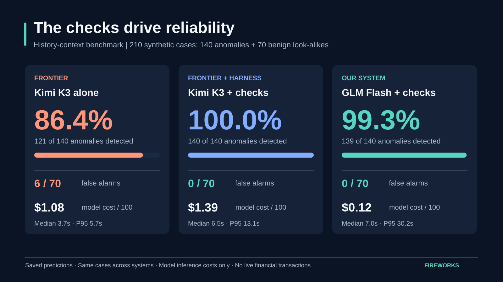
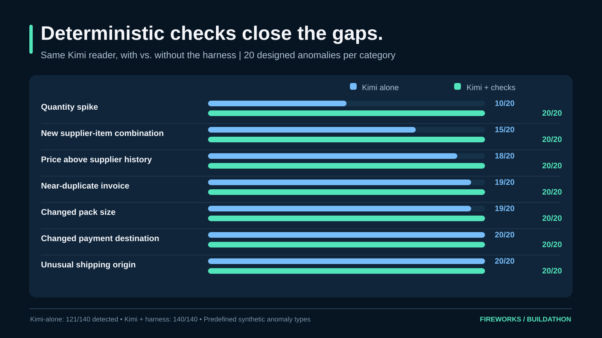
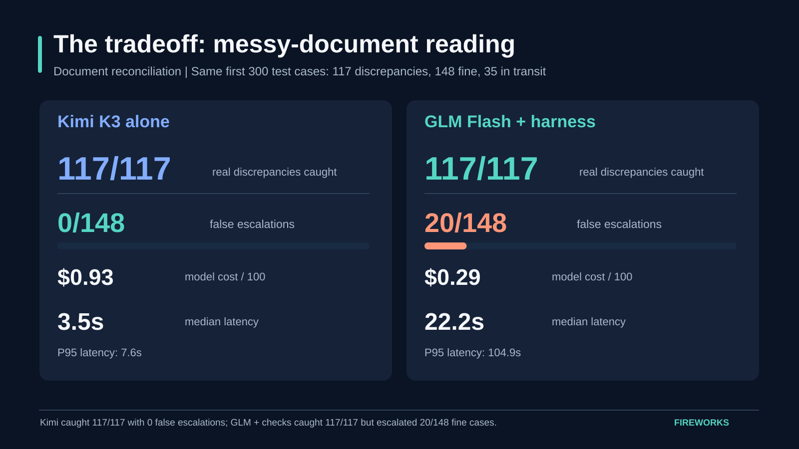
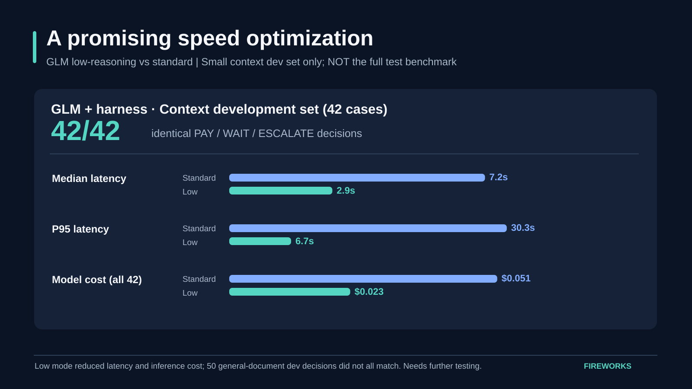
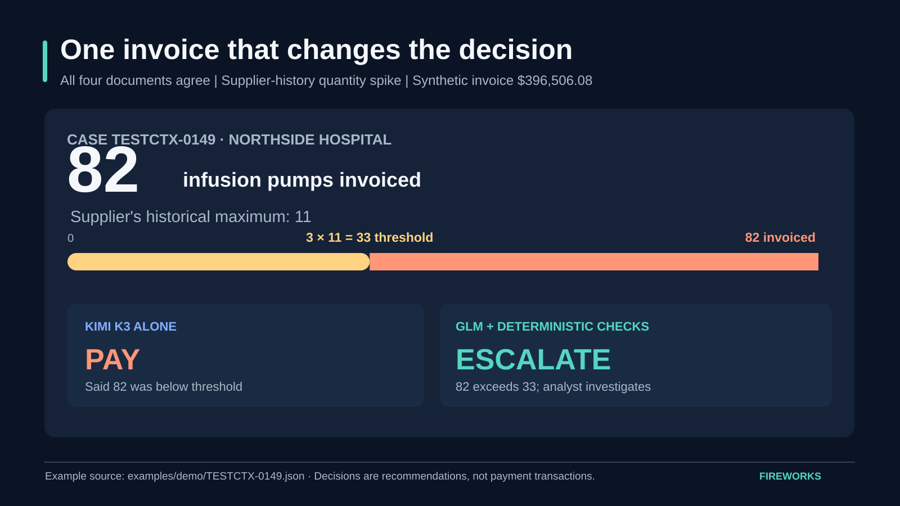

# Demo results and figures — Fireworks Buildathon

**Prepared:** 2026-11-02 · **Evaluation source commit:** `e212fb740c2f93c5b1f66351bfeb0b253a686853` · **Status:** generated from committed predictions, not new inference runs.

Use the graphics below in a live presentation, README, or slides. All five are 16:9 self-contained SVG files. This page is presentation material, not a claim of production accuracy.

## Recommended presentation order

### 1. The main finding — harness reliability

**Say:** "On 210 synthetic history-context cases, Kimi K3, explicitly told to check supplier history, escalated 121 of 140 designed anomalies; with deterministic checks, Kimi found 140 and our smaller GLM system found 139. The GLM harness made zero false escalations among 70 benign look-alikes, and had lower model inference cost."

| Metric on 210 context cases | Kimi alone, explicit checks | Kimi + harness | GLM + harness |
|---|---:|---:|---:|
| Anomalies detected | 121/140 | 140/140 | 139/140 |
| Recall | 86.4% | 100.0% | 99.3% |
| False escalations on benign | 6/70 | 0/70 | 0/70 |
| Model cost per 100 invoices | $1.080 | $1.391 | $0.118 |
| Median / P95 inference latency | 3.7s / 5.69s | 6.54s / 13.05s | 7.02s / 30.22s |
| Execution errors in saved run | 0/210 | 0/210 | 0/210 |

The GLM harness's model cost was 91.5% below the Kimi harness's on this test. That does **not** include human-review or system operating costs. The GLM system is slower than the standalone Kimi model.

### 2. Where improvements appear by anomaly type

**Say:** "The largest gaps in Kimi-alone detection were quantity spikes (10/20) and new supplier-item combinations (15/20). With explicit code checks, GLM found 20/20 in both categories."

The test includes seven **predefined** anomaly categories. A fraud detector would need a much broader and independently sourced evaluation.

### 3. The tradeoff we should acknowledge

**Say:** "The frontier model performs better on messy but legitimate documents. In 300 matched document cases, both caught all 117 true discrepancies, but GLM plus checks escalated 20 of 148 legitimate invoices while Kimi escalated zero. We trade off inference cost against extraction robustness and latency."

| Metric on first 300 document cases | Kimi alone | GLM + harness |
|---|---:|---:|
| True discrepancies caught | 117/117 | 117/117 |
| Correct invoices falsely escalated | 0/148 | 20/148 |
| Goods in transit correctly WAIT | 35/35 | 34/35 |
| Model cost / 100 | $0.925 | $0.292 |
| Median / P95 latency | 3.47s / 7.62s | 22.17s / 104.94s |

**Important:** Kimi has saved predictions for all 1,000 document cases; the *matched comparison* is only the first 300, because the GLM harness only has 300 committed predictions. Do not present these 300 as an independently randomized sample. Their selection was the first 300 cases.

### 4. Promising but preliminary inference optimization

**Say:** "On a 42-case context *development* set, low-reasoning GLM returned the same actions as standard GLM, while cutting observed inference latency and model cost. That is early evidence, not a full-test claim."

| Context development (42 cases) | Standard GLM | Low-reasoning GLM |
|---|---:|---:|
| Same actions vs other configuration | 42/42 | 42/42 |
| Model cost, 42 cases | $0.0513 | $0.0232 |
| Median latency | 7.18s | 2.90s |
| P95 latency | 30.25s | 6.74s |

**Caution:** On the 50-case general-document dev set, the two configurations did **not** always make the same decisions; low mode should not be described as proven equally accurate. Current `harness/config.py` exposes `GLM_REASONING=low`; these results are from `runs/glm_harness_wiki_low/` compared with standard files.

### 5. One concrete, evidence-grounded example

**Case `TESTCTX-0149`:** Northside Hospital Supply, synthetic invoice $396,506.08 for **82** infusion pumps. The supplier's historical maximum for that buyer and item was **11**. The specified spike rule is **more than 3×** history, i.e. more than 33. Kimi alone was explicitly told to check this rule but recommended `PAY`, incorrectly saying the quantity was below the threshold. The GLM harness produced `ESCALATE`, `quantity_spike`.

Grounded example: `examples/demo/TESTCTX-0149.json`. This is a decision recommendation, not a payment transaction or verified fraud case.

## How these figures were prepared

- **Primary saved-data sources:** `docs/results/dashboard/summary.json` and `docs/results/dashboard/by_type.json`. Rebuild those files without running inference using `python3 eval/dashboard_data.py`.
- **Individual prediction sources:** `runs/kimi_alone/test_context.jsonl`, `runs/kimi_harness_wiki/test_context.jsonl`, `runs/glm_harness_wiki/test_context.jsonl`, `runs/kimi_alone/test.jsonl`, `runs/glm_harness_wiki/test.jsonl`.
- **Low-mode files:** `runs/glm_harness_wiki_low/dev_context.jsonl` versus `runs/glm_harness_wiki/dev_context.jsonl`.
- All chart numbers are copied/computed from committed results. No new inference was run. Costs are token-rate-based model estimates (not all-in business costs); latencies are those recorded in predictions. Saved cache/retry semantics should be considered when interpreting live performance.
- These are synthetic, predefined anomalies. Supplier histories are based on synthetic training records rather than a verified supplier master. Some prompt changes followed inspection of initial test results; independent untouched validation would strengthen claims.
- **Do not use** the old 19/140 original Kimi baseline as the primary fair comparison; the new explicit-instruction result is 121/140.
- UI/demo note: `dashboard/README.md` discloses that the existing dashboard design uses answer-key-based highlights; use `TESTCTX-0149` saved outputs as evidence rather than presenting gold-label-derived highlights as inferred evidence.

## Recommended 100-second narrative

1. **0–15s:** Four-way matching can succeed while supplier-history checks find a concerning change.
2. **15–40s:** Show `TESTCTX-0149`: 82 invoiced versus previous max 11, threshold 33; the frontier model recommended PAY while deterministic code correctly flagged it.
3. **40–65s:** Show the 140-case anomaly comparison and model inference cost.
4. **65–85s:** Show one tradeoff chart: false escalations and latency for messy documents.
5. **85–100s:** Finish: *smaller model + explicit verifiable checks + human review*; limitations are stated.

**Recommended demo message:** "It is not about making the model smarter. It is about making important checks explicit, repeatable, and auditable."
