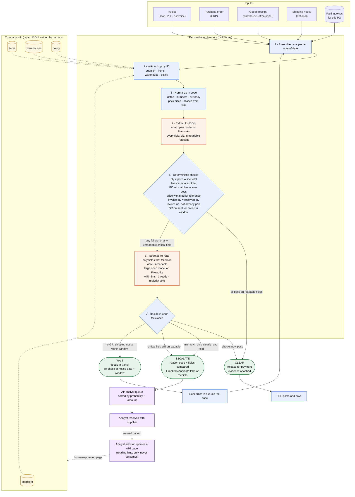

# System flow

How one invoice moves through the system, from arrival to one of three outcomes. This is the production shape. The benchmark in [plan.md](plan.md) exercises everything inside the dashed box; the boxes outside it are described in the demo, not built today.

## What each step guarantees

| Step | Who does it | Guarantee |
|---|---|---|
| 1 Assemble | code | Every arm and every run sees the same packet. Nothing is fetched later. |
| 2 Wiki lookup | code | Deterministic, by ID. No search, no retrieval error. Missing page is fine. |
| 3 Normalize | code | One canonical form for dates, numbers, units and names before any model sees them. |
| 4 Extract | small model | Structured JSON with a status per field. The model may not guess a value it cannot read. |
| 5 Checks | code | Arithmetic and cross-document comparison. This is the authority. A model never overrides it. |
| 6 Re-read | large model | Spends tokens only on fields that failed. Wiki pages tell it where to look and what is authoritative. |
| 7 Decide | code | Fail closed. The only path to CLEAR is every check passing on fields marked readable. |

## Where the model is and is not

The two orange boxes are the only places a model runs. It reads. It does not decide, approve, compute totals, invent conversions, or widen tolerances. Everything a judge or auditor would want to trace is in the blue boxes and is deterministic.

## The learning loop

The dotted path from the analyst back to the wiki is how the system gets better per company. A reviewer who clears a case because "this supplier writes the received count by hand" records that once, as a typed page with an author, approver and expiry. The next invoice from that supplier is read correctly and never reaches the queue. Nothing extracted from a document is ever written to the wiki automatically. This loop is described in the demo and is not built today.

## Three outcomes, three destinations

| Outcome | Goes to | Counts as a human escalation |
|---|---|---|
| CLEAR | ERP, posted and paid | No |
| WAIT | Scheduler, re-queued after the notice window | No |
| ESCALATE | Analyst queue, with reason code, fields compared, and candidate matches attached | Yes |

The benchmark measures how often agreeing invoices end up in the third row, while every real discrepancy must end up there.
